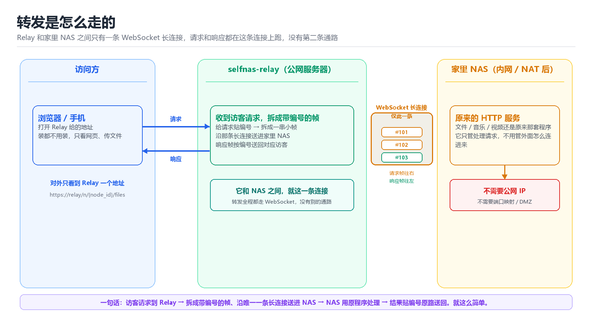
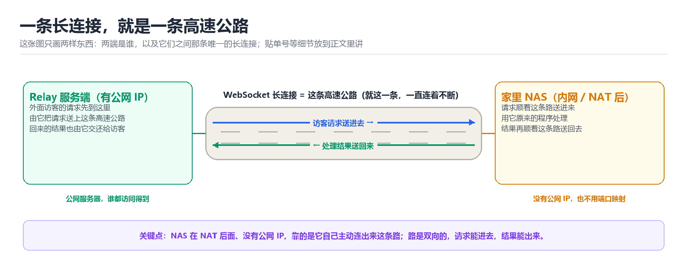
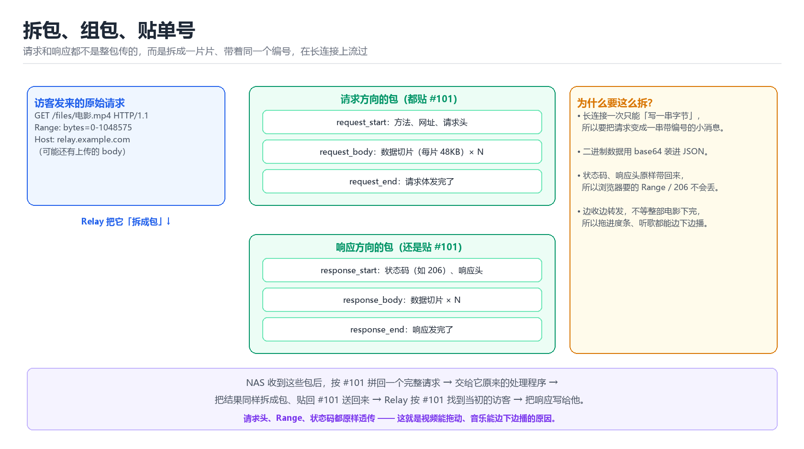
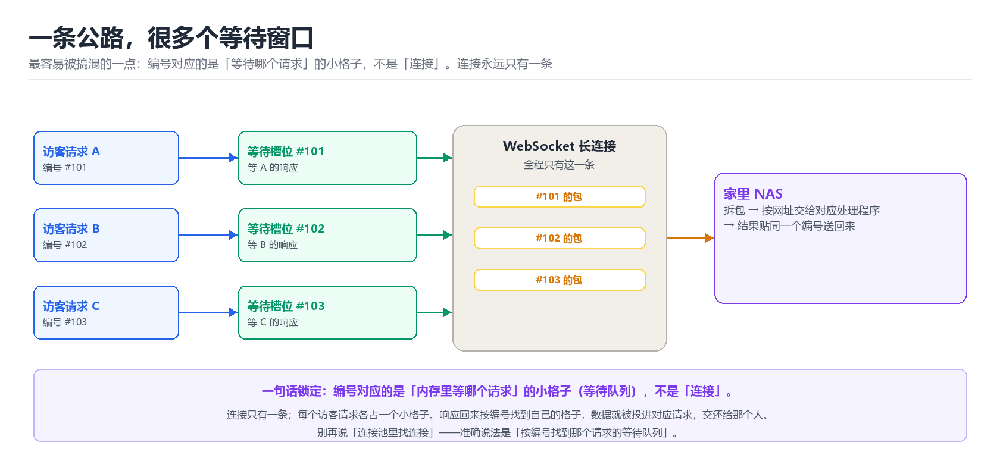
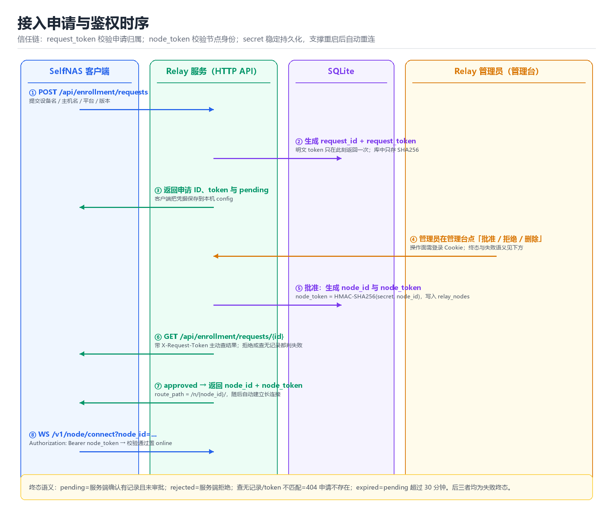
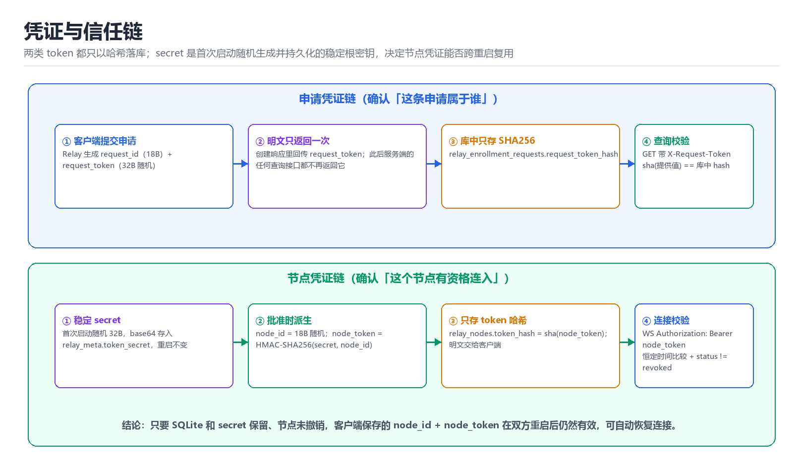
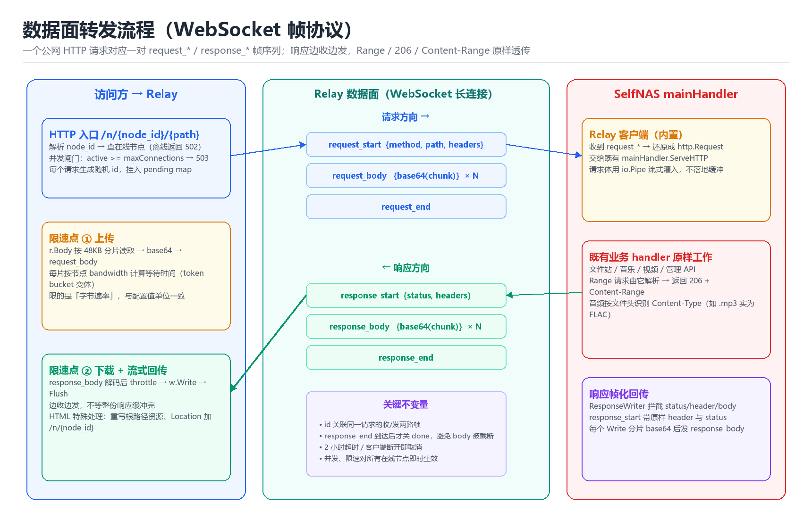
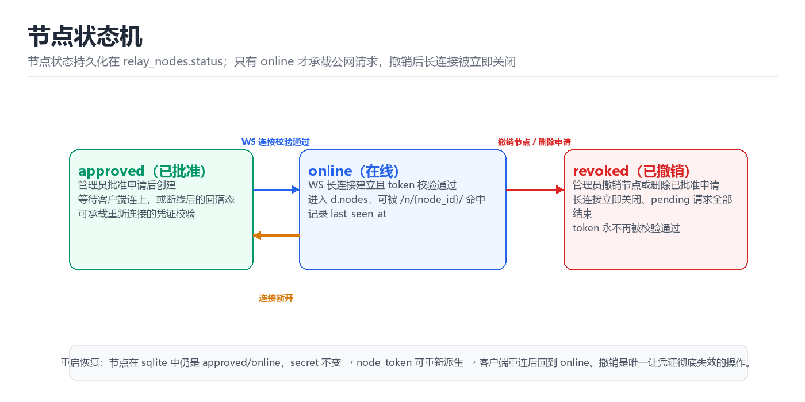

# selfnas-relay

SelfNAS 的独立自建中转服务（self-hosted relay）。

它解决一个问题：**家里的 SelfNAS 没有公网 IP、也被路由器 NAT 挡着，人在外面却想用浏览器直接访问它。** selfnas-relay 让你在自己有公网 IP 的服务器上跑一个中转节点，把公网请求安全地送回内网的 SelfNAS，而 SelfNAS 一端不需要做任何端口映射、DMZ 或公网 IP 配置。

服务端使用 SQLite 文件数据库（默认 `data/relay.db`）持久化管理员、申请、节点、限速和密钥，不使用内存演示数据，也没有默认密码。

---

## 目录

文档按「先总后分」组织：**先看总体**建立全局印象 → **再懂原理**用大白话讲清转发 → **深入细节**给想看实现的人 → **部署使用**落地操作。只想知道大概的，读完第一部分就够了。

**一、先看总体**
- [一句话原理](#一句话原理)
- [总体架构](#总体架构)

**二、再懂原理（大白话）**
- [大白话讲原理：一条公路、一堆快递单号](#大白话讲原理一条公路一堆快递单号)

**三、深入细节**
- [两个通道：管理面与数据面](#两个通道管理面与数据面)
- [接入申请与鉴权](#接入申请与鉴权)
- [凭证与信任链](#凭证与信任链)
- [数据面转发原理](#数据面转发原理)
- [为什么 Range / 206 / 视频拖拽能正常工作](#为什么-range--206--视频拖拽能正常工作)
- [HTML 页面里的路径重写](#html-页面里的路径重写)
- [限速与并发](#限速与并发)
- [节点状态机与重启恢复](#节点状态机与重启恢复)
- [数据库结构](#数据库结构)

**四、部署与使用**
- [快速开始](#快速开始)
- [构建：只提供 Windows 与 Linux 两个版本](#构建只提供-windows-与-linux-两个版本)
- [API 一览](#api-一览)
- [安全边界与已知约束](#安全边界与已知约束)
- [开发与测试](#开发与测试)

---

> **第一部分 · 先看总体** —— 两节内容，让你 30 秒看懂 selfnas-relay 是什么、由谁组成、怎么连。

### 一句话原理

> 内网 SelfNAS **主动**连出一条到公网 Relay 的 WebSocket 长连接；WebSocket 是双向的，于是 Relay 可以沿这条已建立的连接，把公网访客的 HTTP 请求以「帧」的形式送回内网，内网的响应再沿同一条连接流式回传。访客只和 Relay 通信，感觉就像直接访问 SelfNAS。

传统直连要求「访问方能主动连到 SelfNAS」，这在 NAT 后面做不到。这里把方向反过来：**由 SelfNAS 主动连出去**，连接一旦建立就是双向通道，端口映射就不需要了。这就是整套系统的核心。

### 总体架构



图里只有一条线——**Relay 和家里 NAS 之间那条 WebSocket 长连接**。访客请求怎么过去、响应怎么回来，全在这一条线上完成，没有第二条通路。三个角色在转发里各干一件事：

| 角色 | 位置 | 在转发里干什么 |
| --- | --- | --- |
| 访问方 | 任意公网 / 手机 / 电视 | 浏览器打开 Relay 给的 `https://relay/n/{node_id}/...` 地址，不装任何客户端；全程只跟 Relay 打交道，不知道 NAS 在哪 |
| selfnas-relay（公网服务器） | 有公网 IP | 收到访客请求 → 拆成带编号的帧 → 沿那条长连接送进内网；响应帧按编号找回对应访客，流式写回 |
| SelfNAS 客户端（内网） | NAT 后 | 主动连出这条长连接；收到帧后还原成普通 HTTP 请求，交给原来的程序处理（文件 / 音乐 / 视频），再把结果帧化送回 |

三个关键点：

- **只要打通一个方向**：由内网 NAS 主动连到 Relay，连上就是双向的，访客的请求能顺着这条路进去；
- **访客和 NAS 之间没有任何直连**：访客只看到 Relay 一个地址，NAS 全程不需要公网 IP，也不需要端口映射或 DMZ；
- **一条线上同时跑很多请求**：靠贴在每帧上的编号区分谁是谁，来去都不串台（具体怎么靠编号分流，下一部分用大白话讲）。

---

> **第二部分 · 再懂原理（大白话）** —— 用聊天式的语言把转发讲明白，不堆术语。看完这部分就够用了；想深挖再看第三部分。

### 大白话讲原理：一条公路、一堆快递单号

#### 先说大家最疑惑的那个问题

看到这里的十有八九会想问：**"家里 NAS 没有公网 IP，还被路由器 NAT 挡着，外面的人连都连不进去。你说就靠一条 WebSocket 连接，凭什么能把外面访客的请求送进家里 NAS，还能把结果送回来？"**

这个问题问到了点子上。常规思路是"访问方主动连到 NAS"，可 NAS 躲在 NAT 后面，这条路根本走不通。selfnas-relay 的做法是把方向**反过来**：

> 由家里 NAS **主动连出来**，连到公网 Relay，建立一条 WebSocket 长连接并保持不断。连接一旦建立就是**双向**的——既然 NAS 能顺着这条路出去，外面访客的请求也就能顺着这条路进来。

#### 把这条连接想成一条高速公路



这张图上只有两样东西：**两端的主体**，和**它们之间那条唯一的长连接**。

- **左端是 Relay 服务端**（有公网 IP，谁都访问得到），**右端是家里 NAS**（在内网里，没有公网 IP）；
- 中间那条**高速公路**，就是两者之间唯一的一条 WebSocket 长连接，一直连着不断；
- 访客的请求先到 Relay，Relay 把它送上这条路、送到家里 NAS；NAS 用原来的程序处理完，结果再顺着这条路送回来，由 Relay 交还给访客。

所以 NAS 不需要公网 IP，也不需要端口映射、DMZ——它只是顺着自己主动连出去的这条路收发东西，就像你在内网能正常刷网页一样，并不需要别人能主动连到你。

那这条路具体怎么跑、多个请求挤在一起怎么不乱？接着往下看。

#### 请求怎么被送过去：贴单号、拆包、按单号分拣

很多人卡在一个地方：**"就一条公路，访客那么多请求同时进来，怎么送？送出去又怎么知道哪个响应是哪个请求的？"**

答案是给每个请求贴一个**编号**，就像快递单号：

1. 访客的请求一到 Relay，Relay 就给它编个号（比如 `#101`），相当于贴了张快递单；
2. Relay 把请求**拆成几个小包**，每个包都贴上 `#101`，一辆接一辆开上公路，送到家里的 NAS；
3. NAS 收到这些包，按 `#101` 把它们**拼回一个完整的请求**，看看网址是什么，交给对应的处理程序（文件、音乐、视频各有各的）；
4. 处理程序干完活，产出的结果**再拆成包、贴回同一个 `#101`**，顺原路送回 Relay；
5. Relay 一看是 `#101`，就找到当初那个访客请求，把数据写回去——访客就看到网页 / 视频 / 音乐了。



所以 **WebSocket 只是一条运货的公路**，真正让一切对上号的，是这三个动作：

- **拆包 / 组包**：一个 HTTP 请求 ↔ 一串带编号的小消息，来回转换；
- **贴编号**：每个请求一个号，去的包和回的包用同一个号；
- **按编号找回请求**：响应回来时靠编号找到它属于谁。

这就是网络里常说的**多路复用**——和 HTTP/2 在一条 TCP 连接上同时跑很多请求，是同一个道理。一条公路，靠单号分流，几十个请求一起跑也不乱。

#### 最容易搞混的一点：编号对应的是"等待格子"，不是"连接"

有人会说："哦，那 Relay 那边应该有个连接池，按编号找到对应的连接发回去吧？"——**不对，这里要拧过来。**

连接从头到尾**只有一条**。编号对应的不是"哪条连接"，而是 Relay **内存里为每个访客请求开的一个小格子（等待队列）**：

- 访客 A 的请求来了 → 开一个"等 A 的响应"的格子，标 `#101`；
- 访客 B → "等 B" 的格子，标 `#102`；访客 C → 标 `#103`；
- 所有格子里的包，**共用同一条公路**送往 NAS；
- 响应带着 `#101` 回来 → Relay 找到"等 A"的那个格子 → 把数据倒进 A 的等待队列 → A 的请求就被唤醒，把响应写给访客 A。

所以准确的说法是"**按编号找到那个请求的等待队列**"，不是"连接池里找连接"。记住：连接只有一条，格子有很多个。



#### 一句话总结这套转发

> 家里 NAS 主动连出一条长连接（公路）→ 访客请求被贴单号、拆成包送上公路 → NAS 按单号拼回请求、交给对应处理程序 → 结果贴同一个单号送回 → Relay 按单号倒进对应请求的等待格子 → 访客收到响应。全程 NAS 不需要公网 IP，也不需要端口映射。

---

> **第三部分 · 深入细节** —— 面向想看实现的人：两条通道、申请鉴权、帧协议、Range 透传、限速、节点状态机等。

### 两个通道：管理面与数据面

Relay 在同一个 HTTP 服务里提供了两套完全不同用途的通道：

#### 1. 管理面（HTTP + 登录 Cookie）

给管理员和 SelfNAS 客户端协商「谁能接入」用，都是普通 HTTP 请求：

- 管理台页面 `/`（静态资源，由 `web/` 通过 `go:embed` 编译进二进制）
- 登录 `/api/login`，会话 Cookie `relay_session`（24 小时，服务端内存会话表）
- 申请 `/api/enrollment/requests`
- 审批 / 拒绝 / 删除 `/api/applications/...`
- 节点列表与撤销 `/api/nodes/...`
- 限速配置 `/api/settings/limits`
- 初始化 `/api/setup/status`、`/api/setup/password`；改密 `/api/password/change`

**首次初始化只能在服务器本机（回环地址）完成**：没有管理员时打开管理台会进入初始化页，设置两次新密码后以 bcrypt 落库。没有公开默认密码。

#### 2. 数据面（WebSocket 长连接 + HTTP 转发）

给真正的文件 / 媒体流量用：

- 节点连接 `GET /v1/node/connect?node_id=...`，请求头 `Authorization: Bearer <node_token>`
- 公网入口 `/n/{node_id}/{path}`
- 少量只读资源兜底：`/api/fs/`、`/api/music/`、`/assets/`（当且仅当只有一台在线节点时，才转发到它）

管理 API 不会被兜底代理，两套通道职责严格分离。

### 接入申请与鉴权



完整流程：

1. **提交申请**：SelfNAS 填 Relay 地址和设备名，POST 到 `/api/enrollment/requests`。Relay 生成 `request_id`（18 字节随机）和 `request_token`（32 字节随机），都做 base64url 编码。
2. **只返回一次的明文**：`request_token` 明文只在创建响应里出现一次，客户端存在本机配置；数据库里只存它的 SHA256。
3. **管理员审批**：管理台列出待审批申请，管理员点批准 / 拒绝 / 删除（需要登录 Cookie）。
4. **批准即创建节点**：Relay 生成 `node_id`（18 字节随机），派生 `node_token = HMAC-SHA256(secret, node_id)`，把节点写进 `relay_nodes`（状态 `approved`，限速继承当前全局默认值）。
5. **客户端主动查结果**：客户端拿 `request_token` 调 `GET /api/enrollment/requests/{id}`，带上 `X-Request-Token` 请求头。返回值只有四种情况：
   - `pending`：服务端确认记录还在、还没审批 → 显示“等待审批”；
   - `approved`：附带 `node_id`、`node_token`、`route_path`，客户端保存后自动连接；
   - `rejected`：服务端明确拒绝 → 失败终态；
   - 404“申请不存在”：记录被删或 token 不匹配 → 失败终态。
6. **建立长连接**：客户端用 `node_token` 连 `/v1/node/connect`，校验通过后节点置为 `online`。

`pending` 申请超过 30 分钟会自动转为 `expired`。

> 客户端对申请记录的处理：已拒绝、已过期、服务端无记录都属于终态，不会再提供“检查结果”按钮；只有待审批可以申请状态下才会去查。删除申请只是删客户端本机记录，不会撤销 Relay 服务端已批准的节点。

### 凭证与信任链



系统里有两类 token，各管一件事，都不以明文落库：

| 凭证 | 生成 | 用途 | 落库形式 |
| --- | --- | --- | --- |
| `request_token` | 申请时 32 字节随机 | 证明“查询结果的人就是当初申请的人” | `request_token_hash = sha256(token)` |
| `node_token` | 批准时 `HMAC-SHA256(secret, node_id)` | 证明“这个节点有资格连入” | `token_hash = sha256(node_token)` |

**根密钥 `secret`** 在数据库首次初始化时随机生成 32 字节，base64 后写入 `relay_meta.token_secret`，此后固定不变。它决定 `node_token` 能否被重新派生。

校验细节：
- 申请查询用恒定时间比较 `sha(请求头里的 token)` 与库里的 `request_token_hash`；
- 节点连接用恒定时间比较 `sha(Bearer token)` 与库里的 `token_hash`，并要求节点状态不是 `revoked`；
- 因为 `secret` 稳定、节点凭证在 `relay_nodes` 里持久保存，**只要数据库和 secret 保留、节点没被撤销，客户端保存的 `node_id + node_token` 在双方重启后仍然有效**，会自动恢复连接。撤销是唯一让凭证彻底失效的操作。

### 数据面转发原理



一个公网 HTTP 请求，在长连接上对应一组带同一 `id` 的帧。帧格式是一个 JSON：

```json
{
  "type": "request_start | request_body | request_end | response_start | response_body | response_end",
  "id": "本次请求的随机关联 ID",
  "method": "GET", "path": "/files/...?...", "headers": {},
  "status": 200, "data": "base64(字节分片)", "error": ""
}
```

请求方向（Relay → SelfNAS）：

1. 访客请求命中 `/n/{node_id}/{path}`，Relay 查在线节点；节点离线返回 502，并发超限返回 503。
2. 生成随机 `id`，在该节点的 `pending` 表里挂一个带缓冲 channel。
3. 发 `request_start`（方法、路径、请求头），请求头原样透传。
4. `r.Body` 按 48 KB 分片读取，每片做限速后 base64 编码，发 `request_body`。
5. 读完发 `request_end`。

响应方向（SelfNAS → Relay → 访客）：

1. SelfNAS 的 Relay 客户端把帧还原成 `http.Request`，请求体用 `io.Pipe` 流式灌入，交给既有 `mainHandler.ServeHTTP`。
2. 一个专门的 `ResponseWriter` 拦截 status / header / body：先发 `response_start`（状态码 + 响应头），每次 `Write` 发一个 `response_body` 分片，结束发 `response_end`。
3. Relay 侧按 `id` 把帧投给对应请求的 channel，解码 base64 后 `w.Write` + `Flush`，**边收边发，不等整份响应缓冲完**。

几个工程细节：

- `response_end` 入队后不会立刻关闭 `done`，而是等消费端真正读到 `response_end` 再关，避免还有 body 帧排队时被 `select` 抢先判结束导致响应被截断（这个坑踩过并修过）。
- 每个请求有 2 小时超时；访客断开连接（`r.Context().Done()`）会立即终止转发。
- 节点断线时，所有挂起的 `pending` 请求会被结束掉，不会无限等待。

### 为什么 Range / 206 / 视频拖拽能正常工作

媒体播放依赖 HTTP 的分段语义：浏览器先发带 `Range: bytes=...` 的请求，服务端回 `206 Partial Content` + `Content-Range`，视频才能拖动进度条、音频才能边下边播。

这套转发能保留 Range 语义，原因是**没有重新实现 HTTP，而是原样透传**：

- 访客请求头（含 `Range`）在 `request_start` 里原样带到 SelfNAS；
- SelfNAS 既有 `mainHandler` 自己解析 Range、决定返回 200 还是 206，并生成 `Content-Range`、`Accept-Ranges`；
- 这些状态码和响应头在 `response_start` 里原样带回来，Relay 直接 `WriteHeader`；
- body 分片流式回传且不缓冲整份文件，所以大文件、长视频的拖拽和续播都不会卡在 Relay 上。

另外音频的 `Content-Type` 由 SelfNAS 按文件头识别（存在扩展名是 `.mp3`、实际是 FLAC 的情况），这部分逻辑也在既有 handler 里，Relay 不干预。

> 说明：以上是转发链路的设计与实现口径。真实浏览器里的多请求并发、大文件、图片/音乐/视频全套端到端表现，需结合实际网络再逐项验收。

### HTML 页面里的路径重写

SelfNAS 前端页面里会有大量以 `/` 开头的资源请求（`/assets/...`、`/api/fs/...` 等）。经 Relay 访问时，这些请求必须带上 `/n/{node_id}` 前缀，否则会打到 Relay 自己的管理台根路径上。

Relay 在转发 `text/html` 响应时做了两件事（`rewriteRelayHTML`）：

1. 把静态 HTML 里 `href="/"`、`src="/"`、`action="/"` 改写成带前缀的形式；
2. 在 `<head>` 里注入一段脚本，运行期拦截这些入口，让**动态生成**的根路径也自动加前缀：
   - `fetch` / `XMLHttpRequest.open`
   - `Element.setAttribute` 的 `src` / `href` / `action`
   - `HTMLImageElement` / `HTMLMediaElement` / `HTMLSourceElement` 的 `src` setter
   - `window.open`
   - 响应头里的 `Location` 跳转也会自动加上 `/n/{node_id}` 前缀。

这样访客点页面里的任何链接、播放器发起的任何请求，都会留在正确的节点转发路径上。

### 限速与并发

管理台的“默认带宽”和“最大并发数”保存在 `relay_settings`，对新旧节点都生效：

- **新批准的申请**直接继承当前全局默认值写入 `relay_nodes`；
- **保存限速设置时**，会同步更新所有未撤销节点的 `relay_nodes` 记录，并更新当前在线节点的内存配置——所以改完立即生效，旧节点不会继续用限速；
- 也可以在节点列表里单独看每个节点的带宽与并发上限。

限速算法（`throttle`，令牌桶变体）：

```
delay = 1 秒 × 本次分片字节数 / 每秒带宽字节数
nextWrite = max(now, nextWrite) + delay
等待到 nextWrite 再放行
```

它按**字节速率**计算，与配置值单位一致（`default_bandwidth_bytes` 是字节/秒）。上传（`request_body`）和下载（`response_body`）两个方向都会限速。并发上限用节点的 `active` 计数控制，超过就返回 503。

### 节点状态机与重启恢复



节点状态存在 `relay_nodes.status`：

- `approved`：已批准、等待连接，或连接断开后的回落态；
- `online`：长连接建立且 token 校验通过，进入内存节点表，可被 `/n/{node_id}/` 命中；
- `revoked`：已撤销，长连接被立即关闭、挂起请求全部结束，token 永不再通过校验。

**重启恢复**：节点记录、token 哈希和 `secret` 都在 SQLite 里。客户端重启后凭保存的 `node_id + node_token` 重连，服务端重新派生/校验成功后把节点置回 `online`。客户端侧断线时会按 1s→30s 指数退避自动重连。

> 注意区分三件事：
> - **断开连接**：停止连接并关闭“重启自动恢复”，但保留本机保存的地址、节点凭证和申请记录；
> - **恢复连接**：用本机保存的凭证重新连接，并恢复“重启自动恢复”；
> - **删除本机连接**：清除本机所有 Relay 地址和凭证，回到未配置状态，需要重新走申请流程。
>
> 这三者都**不会**撤销 Relay 服务端节点；撤销只能在管理台操作。

### 数据库结构

所有数据落在一个 SQLite 文件里（默认 `data/relay.db`）：

| 表 | 内容 |
| --- | --- |
| `relay_admins` | 管理员账号、bcrypt 密码哈希、是否强制改密 |
| `relay_meta` | 根密钥 `token_secret` |
| `relay_enrollment_requests` | 接入申请：设备信息、token 哈希、状态、审批时间、关联 node_id |
| `relay_nodes` | 节点：node_id、token 哈希、状态、带宽、并发上限、最后在线时间 |
| `relay_settings` | 全局默认限速配置 |

所有时间字段在 SQLite 里是文本，读取时按字符串处理（历史 bug 曾因把文本时间扫进时间类型导致节点列表为空，已修复并有回归测试）。

---

> **第四部分 · 部署与使用** —— 怎么把它跑起来、构建哪些平台版本、对外接口和需要注意的安全边界。

### 快速开始

#### 1. 配置环境变量

复制 `deploy/env.example` 为 `.env`，按需修改（监听地址 / 端口 / 数据库路径 / 管理员用户名）：

```text
RELAY_LISTEN_ADDR=0.0.0.0
RELAY_LISTEN_PORT=8080
RELAY_SQLITE_PATH=data/relay.db
RELAY_ADMIN_USER=admin
```

程序本身只认环境变量，不会自动读 `.env` 文件——**Linux 用随包提供的 `start.sh` 启动即可，它会自动加载 `.env`**（见下一步）。不用脚本时，也可以自己 `export` 这些变量或用 systemd 的 `Environment=` 注入。

#### 2. 启动

**Linux（推荐用随包的启动脚本，支持 start / stop / restart / status）：**

```bash
chmod +x start.sh          # 解压后给脚本一次执行权限
./start.sh start           # 启动（后台运行，PID 写 relay.pid，日志写 relay.log）
./start.sh status          # 查看运行状态
./start.sh restart         # 重启
./start.sh stop            # 停止
```

脚本会加载 `.env`、给 `relay` 加执行权限、后台启动并记录 PID；`stop` 按 PID 结束进程（会核对确属本程序的 relay，不会误杀别的进程）。日志在 `relay.log`，排障直接看它。

**Windows：** 双击 `relay.exe` 启动（或命令行 `relay.exe`）；环境变量可在 PowerShell 里用 `$env:RELAY_LISTEN_PORT=8080` 之类设置。

> 也可以直接用 systemd 托管：写一个 unit，`WorkingDirectory` 设为解压目录，`ExecStart` 指向 `relay`，需要改端口/路径就用 `Environment=` 注入上面那些变量。

#### 3. 首次初始化

在**服务器本机**打开 `http://127.0.0.1:8080/`，进入初始化页，设置两次新密码（至少 8 位）。初始化接口只接受回环地址请求。

#### 4. 接入 SelfNAS

在 SelfNAS 管理台的“外网访问 → 自建 Relay”里填入 Relay 地址和设备名提交申请；回到 Relay 管理台批准；再到 SelfNAS 点“检查结果”，拿到节点凭证后会自动连接。连接成功后页面会显示完整外网访问地址：

```text
http(s)://<relay-host>:<port>/n/<node_id>/files
```

#### 健康检查

```text
GET /healthz  →  {"code":0,"data":{"status":"ok"}}
```

### 构建：只提供 Windows 与 Linux 两个版本

**本项目只编译 Windows 和 Linux 两个平台版本，不提供 macOS 版本。** 原因很直接：selfnas-relay 是部署在服务器上的常驻服务，实际部署环境只有 Windows 服务器和 Linux 服务器，没有 macOS 服务器；因此不维护 macOS 构建。

Linux 提供两种 CPU 架构，按服务器选对应的包：

| 平台 / 架构 | 适用 | 包名 |
| --- | --- | --- |
| Windows amd64 | Windows 服务器 / PC | `selfnas-relay-v*-windows-amd64.zip` |
| Linux amd64 | 常见的 x86_64 服务器 | `selfnas-relay-v*-linux-amd64.zip` |
| Linux arm64 | ARM 服务器、ARM 开发板、部分云主机 | `selfnas-relay-v*-linux-arm64.zip` |

不确定服务器架构时，在 Linux 上执行 `uname -m`：`x86_64` 选 amd64，`aarch64` / `arm64` 选 arm64。

交叉编译命令（`go build` 纯 Go + CGO_ENABLED=0，SQLite 用的是纯 Go 实现 `modernc.org/sqlite`，无需本地 C 库）：

```bash
# Windows amd64（产出 relay.exe）
CGO_ENABLED=0 GOOS=windows GOARCH=amd64 go build -o relay.exe ./cmd/relay

# Linux amd64（产出 relay）
CGO_ENABLED=0 GOOS=linux   GOARCH=amd64 go build -o relay    ./cmd/relay

# Linux arm64（产出 relay）
CGO_ENABLED=0 GOOS=linux   GOARCH=arm64 go build -o relay    ./cmd/relay
```

在 Windows 上用 PowerShell 交叉编译 Linux 版（把 `GOARCH` 改成 `arm64` 即出 arm64 版）：

```powershell
$env:CGO_ENABLED=0; $env:GOOS='linux'; $env:GOARCH='amd64'   # 或 'arm64'
go build -o relay ./cmd/relay
```

> 说明：这里是“Relay 服务端只有 Windows / Linux 两平台”。SelfNAS 客户端本身是另一个项目，其多平台构建不在本文范围内。

### API 一览

| 方法 | 路径 | 鉴权 | 说明 |
| --- | --- | --- | --- |
| GET | `/healthz` | 无 | 健康检查 |
| GET | `/api/setup/status` | 无 | 是否需要初始化 |
| POST | `/api/setup/password` | 仅本机 | 首次设置管理员密码 |
| POST | `/api/login` / `/api/logout` | 无 | 登录 / 登出 |
| GET | `/api/me` | Cookie | 当前账号信息 |
| POST | `/api/password/change` | Cookie | 修改密码 |
| POST | `/api/enrollment/requests` | 无 | 提交接入申请 |
| GET | `/api/enrollment/requests/{id}` | `X-Request-Token` | 查询申请结果 |
| GET | `/api/applications` | Cookie | 申请列表 |
| POST | `/api/applications/{id}/approve\|reject\|delete` | Cookie | 审批 / 拒绝 / 删除申请 |
| GET | `/api/nodes` | Cookie | 节点列表与统计 |
| POST | `/api/nodes/{id}/revoke` | Cookie | 撤销节点 |
| GET/PUT | `/api/settings/limits` | Cookie | 读取 / 保存默认限速 |
| GET | `/v1/node/connect?node_id=...` | `Authorization: Bearer` | 节点 WebSocket 长连接 |
| GET/POST/... | `/n/{node_id}/{path}` | 节点在线 | 公网数据转发入口 |

### 安全边界与已知约束

- **管理接口应放在可信网络内**：初始化接口严格只接受回环地址；日常管理 API 依赖登录 Cookie。不要把管理台直接暴露到公网，建议用反向代理 + HTTPS + IP 白名单，或限制只监听内网网卡；对外只暴露 `/n/` 数据面路径。
- **令牌只以哈希落库**：`request_token` 和 `node_token` 明文都不写数据库；前者只在创建时返回一次，后者只在批准时通过查询接口返回一次。
- **secret 必须备份**：`relay_meta.token_secret` 丢失会导致所有已发节点凭证失效、需要重新申请。备份 `data/relay.db` 即包含它。
- **单 Relay**：一台 SelfNAS 当前只连接一台 Relay（客户端侧单个全局连接状态），不支持多 Relay 并行。
- **资源兜底限制**：`/api/fs/`、`/api/music/`、`/assets/` 这类根路径兜底只在“恰好一台节点在线”时生效；多节点时请统一使用带 `/n/{node_id}` 的明确路径。
- **媒体链路**：转发保留 Range / 206 / 流式语义，但真实浏览器并发、大文件与各媒体格式的端到端表现需结合实际网络验收；本项目的实现口径见上文“数据面转发原理”。

### 开发与测试

```bash
go test ./...                 # 含 SQLite 文本时间、限速生效、节流等回归测试
go build ./cmd/relay          # 构建
python docs/draw_diagrams.py  # 重新生成本文档中的配图（需要 Pillow）
```

配图源文件在 `docs/draw_diagrams.py`，改图后重跑即可，无需外部绘图工具。
